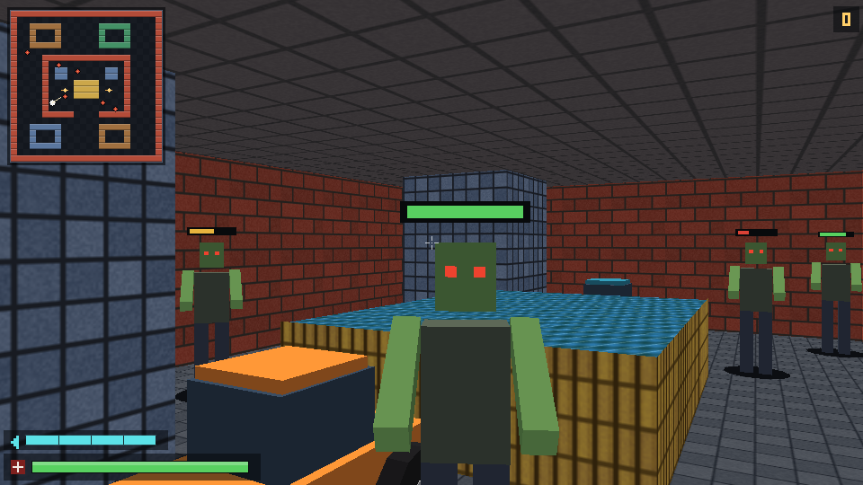
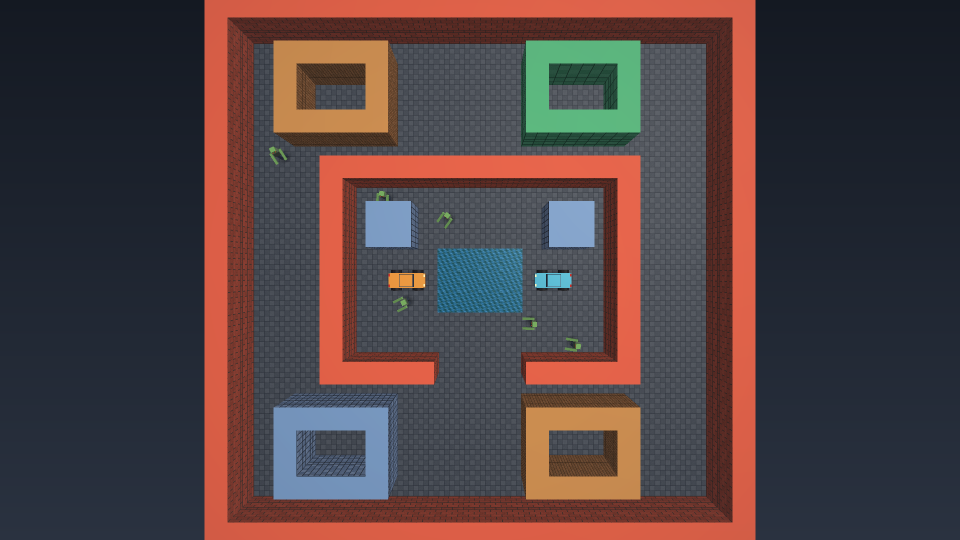
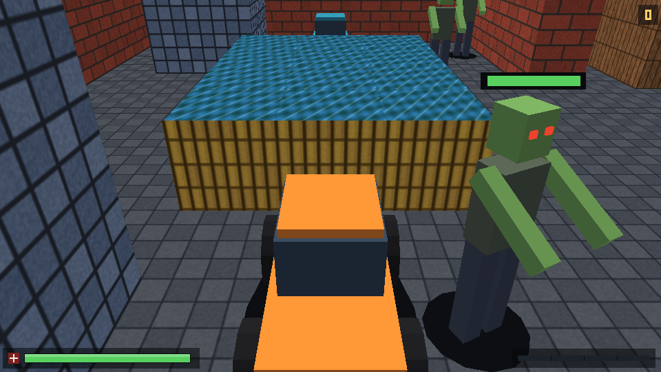
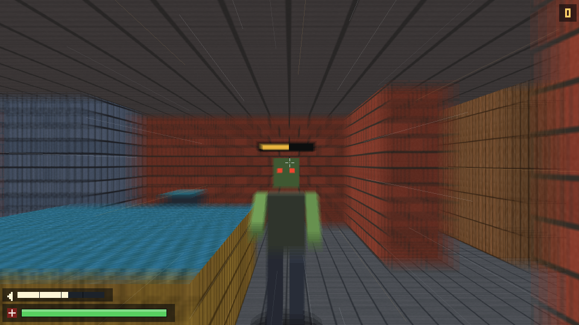
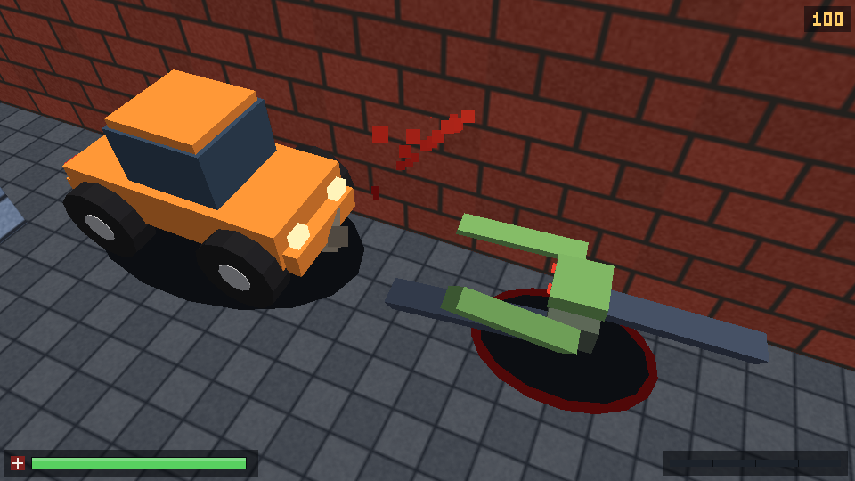

# ai-agent-test

Repository for Superagent tasks.

## Museum 3D

`game3d` is a dependency-free C++17 3D game. It replaces the repository's ray
casting renderer with a real software 3D pipeline: model, view and projection
transforms, near-plane clipping, perspective divide, depth-buffered triangle
rasterization, perspective-correct texture mapping with mip levels, directional
lighting and distance fog. The museum map, zombie combat and controls from the
old demo are preserved, two drivable cars have been added to the map, and the
game now revolves around a signature **Shift dash** plus speed-scaled
vehicle-versus-zombie combat.



*First-person view at the default spawn with the minimap enabled. The orange car
is parked ahead, a zombie is closing in, and its health bar is drawn as a
depth-tested 3D billboard. The bottom-left HUD now shows health and the dash
meter; the score is in the top-right corner.*



*The `--map` camera: a real overhead 3D view of the museum. Room shapes,
interiors, wall tops, the fountain and both cars are visible; there is no ray
fan or other 2D projection.*



*Driving vehicle 0 with the wall-aware third-person chase camera. The speed
meter is in the bottom-right corner.*



*The dash capture: motion blur, radial speed streaks and the active dash meter
while the player bursts toward a zombie. The score sits in the top-right
corner.*



*The impact capture: a high-speed car hit has killed and flattened a zombie,
sent blood particles flying and left a blood pool under the ragdoll.*

### Build and run

Requires a C++17 compiler. Interactive mode additionally needs a POSIX terminal
with 24-bit color support (Linux, macOS, WSL and most modern terminals qualify).

```sh
make
./game3d
```

The demo opens in an interactive first-person view.

| Input | On foot | In a vehicle |
| --- | --- | --- |
| `W`/`S` or `Up`/`Down` | Move forward/backward | Accelerate / brake and reverse |
| `A`/`D` | Strafe left/right | Steer left/right |
| `Left`/`Right` | Turn | Steer left/right |
| `Shift`+`W`/`A`/`S`/`D`, or `F` | Dash forward/left/back/right, or forward | — |
| `E` | Enter a nearby vehicle | Exit the vehicle |
| `Space` | Fire at the zombie under the crosshair | — |
| `Tab` | Toggle the overhead 3D map | Toggle the overhead 3D map |
| `M` | Toggle the minimap | Toggle the minimap |
| `R` | Restart | Restart |
| `Q`/`Esc` | Quit | Quit |

Vehicles can only be entered or exited when slow enough to stop safely; the
player is placed on walkable ground when leaving a car.

### Shift dash

Shift is the game's signature move. A terminal cannot report a bare modifier key
press, so the dash is bound to **Shift plus a direction** (`Shift+W` is a forward
dash, `Shift+A` dashes left, `Shift+D` right, `Shift+S` back). `F` is an
always-available forward-dash fallback.

- The burst lasts `0.24 s` at `12 m/s`, about three metres, and ignores shooting.
- Zombies caught in the dash take `80` damage, are knocked back and bleed; a dash
  kill is worth `150` score and builds a short-lived combo up to `x5`.
- The whole burst is invulnerable to zombie melee, so dashing through an attack
  is the core survival skill. A dash kill shaves `0.22 s` off the next cooldown.
- The cooldown is `1.6 s` from activation; the bottom-left meter fills as it
  recharges and pulses when ready.
- Feedback is a radial motion blur, animated speed streaks, camera shake, dust
  and blood particles, and terminal-bell audio.

### Vehicle-vs-zombie combat

Driving into a zombie now transfers momentum. Contact is detected against the
car's two-circle hull whenever the car is moving faster than `1 m/s`; damage
grows linearly with speed, from about `10` at crawling pace to `145` at the
speed cap. Fast hits kill outright, flatten the corpse and throw it; slower hits
wound, stun and shove the zombie aside. Every impact plays the impact sound and
spawns blood and dust. A killing hit adds `100` score. The car is not stopped by
zombies, so a full-speed run through a group is the fastest way to clear a lane.

Terminal audio is the terminal bell (`--no-sound` disables it); it is the only
dependency-free audio channel available to a POSIX terminal game.

### Rendering frames and screenshots

```sh
./game3d --render frame.ppm --width 960 --height 540 --minimap
./game3d --render map.ppm --width 960 --height 540 --map
./game3d --render drive.ppm --width 960 --height 540 --drive 0
./game3d --render dash.ppm --width 960 --height 540 --dash
./game3d --render impact.ppm --width 960 --height 540 --impact
python3 tools/ppm_to_png.py frame.ppm frame.png
```

`make screenshots` regenerates the five images above; the PNG converter uses
only the Python standard library. `--dash` and `--impact` run the real update
loop for a few frames before capturing, so they show live simulation state
rather than a posed frame. Rendering a 960x540 frame takes roughly 0.2 s on a
current laptop CPU, and interactive frames use the much smaller terminal
resolution.

Useful options (also listed by `./game3d --help`):

| Option | Meaning |
| --- | --- |
| `--render <file.ppm>` | Render one frame and exit |
| `--map` | Overhead 3D map view |
| `--minimap` | Draw the minimap in the first-person view |
| `--drive <n>` | Start inside vehicle `n` (0-based) |
| `--dash` | Capture the Shift-dash demo state |
| `--impact` | Capture the vehicle-impact demo state |
| `--no-sound` | Disable terminal-bell audio feedback |
| `--width`, `--height` | Output size (default 960x540) |
| `--fov <deg>` | Horizontal field of view (default 75) |
| `--pos <x>,<y>` | Start position (default 6.5,14.5) |
| `--angle <deg>` | Start angle: 0 = east, 90 = south (default 330) |
| `--fps <n>` | Interactive frame cap (default 30) |
| `--selftest` | Run built-in checks |

### How it works

- **Rendering pipeline.** Geometry is submitted as triangle meshes with a model
  matrix and a material. Every vertex goes through model, view and projection
  transforms; triangles are back-face culled in world space and clipped against
  the near plane in view space. Clipped polygons are fan-triangulated, projected
  to the viewport and rasterized with an edge-function scan converter. A
  reciprocal-w depth buffer resolves occlusion, while `1/w`-weighted
  interpolation keeps world position, normals and UVs perspective-correct.
- **Textures and lighting.** Materials sample tiling procedural textures
  (brick, stone, painted panels, wood, gold, water, floor and ceiling) with
  bilinear filtering and an automatically generated mip chain. A directional
  light, ambient term and small ceiling bounce term shade each pixel, and
  distance fog fades the far end of the museum.
- **Map.** The original 24x24 grid with five wall materials is unchanged. It is
  extruded into 3D: exposed wall faces are generated per grid cell, wall tops
  are included for the overhead camera, the floor and ceiling are textured
  planes, and the golden fountain is a low water basin. Rooms, doorways,
  pillars and the layout match the previous demo.
- **Zombies.** Zombies are articulated low-poly models (torso, head, arms and a
  two-frame walk swing) instead of sprites. A depth-tested 3D billboard health
  bar follows each living zombie. Los-blocked zombies shuffle toward the player,
  attack in melee, respawn after a few seconds and can be shot with the same
  hitscan rules as before. Killed zombies become ragdolls: they tumble, slide,
  leave a blood pool and fade out instead of vanishing on the spot.
- **Shift dash.** The dash is a fixed-direction burst at `12 m/s`: the player
  moves along the stored dash direction, collides with walls and cars, and
  sweeps a hit radius through zombies. Each dash has a unique id so one burst
  can hit each zombie at most once. Hits apply damage, knockback and blood,
  award combo-scaled score on kills, and shorten the cooldown. While the burst
  lasts zombie melee is ignored, which makes dashing through an incoming attack
  the main defensive technique.
- **Vehicles.** Two cars are parked in the atrium. Each is built from boxes and
  twelve-sided wheel cylinders, with paint, glass, headlights, tail lights and a
  ground shadow. Driving uses an arcade bicycle model: throttle acceleration,
  braking, reverse, drag, speed-sensitive steering and a speed cap. Front wheels
  steer and all wheels spin. Collision uses a two-circle hull against the grid:
  blocked movement slides along walls, frontal impacts damp the speed, turning
  into a wall is rejected, cars cannot overlap each other, and zombies are
  pushed out of a car's hull. The chase camera shortens its boom when a wall is
  behind the car, so it stays inside the museum.
- **Vehicle combat.** Every moving car tests its hull against living zombies.
  The impact damage is `10 + 26 * (speed - 1)` and the knockback impulse grows
  with speed. High-speed hits set the zombie's `flattened` ragdoll flag; all
  kills add score, spawn blood/dust and queue an impact sound. A per-zombie
  cooldown prevents one contact from draining a whole health bar over several
  frames.
- **Effects.** Blood and dust are short-lived billboard particles with gravity
  and drag; dash dust and the speed streak layer add the sense of a burst.
  Camera shake is applied to the view matrix, and a radial multi-tap blur is
  applied to the frame buffer while the dash is active. Audio is the terminal
  bell, queued as simulation events so the renderer and tests stay deterministic.
- **Gameplay rays.** The renderer no longer uses ray casting. A grid DDA routine
  remains in the simulation for line-of-sight checks, zombie hitscan and
  third-person camera clearance; it never produces pixels.
- **HUD.** The player health bar, dash cooldown meter, score/combo readout,
  crosshair, minimap (now with vehicle markers) and driving speed meter are
  drawn directly into the frame buffer after the 3D pass. Damage, death and
  muzzle flashes are preserved.

### Verification

```sh
make test
```

The built-in selftest checks matrix/projection math, texture sampling and mip
levels, rasterization, depth buffering, back-face culling, near-plane clipping,
map and spawn invariants, 1200 random gameplay rays against a brute-force march,
zombie hitscan/occlusion/chase/melee/respawn behaviour, vehicle entry/exit,
acceleration, braking, reverse, steering, speed caps, wall and car collisions,
dash burst speed/cooldown/invulnerability/kills/score, speed-scaled vehicle
damage, knockback, ragdoll flattening, particle effects, respawn cleanup,
first-person/chase/overhead rendering, zombie depth occlusion and PPM output.

The project builds cleanly with `-Wall -Wextra -Wpedantic -Werror`. The GitHub
Actions workflow in `.github/workflows/build.yml` builds it, runs the selftest
and renders all five views.

### Migration notes

The old `raycasting.cpp` renderer and its per-column DDA wall slices, floor
casting, sprite depth buffer and ray-fan map have been removed. The map layout,
spawn point, movement and combat controls, zombie behavior, health bars and
minimap were carried over. The top-down ray view was replaced by a real overhead
3D camera, and the minimap now also shows vehicles.

Because the project is a dependency-free terminal application, "equivalent for
your stack" means implementing the same pipeline stages WebGL/Three.js would
drive on a GPU, in software on the CPU. It keeps the existing build, selftest,
CI and PPM screenshot workflow without adding a browser or graphics runtime.
The pre-migration screenshots remain available in git history at commit
`7d725db`.
