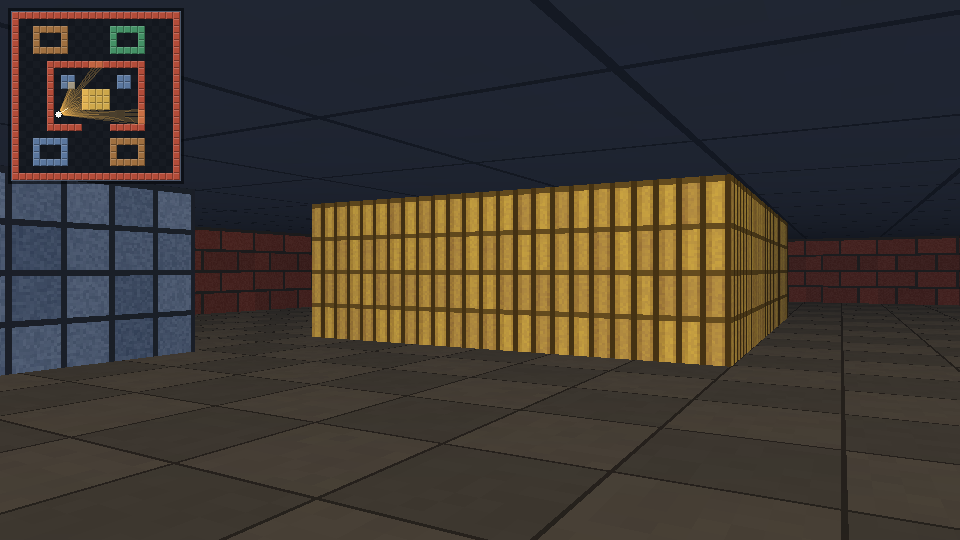
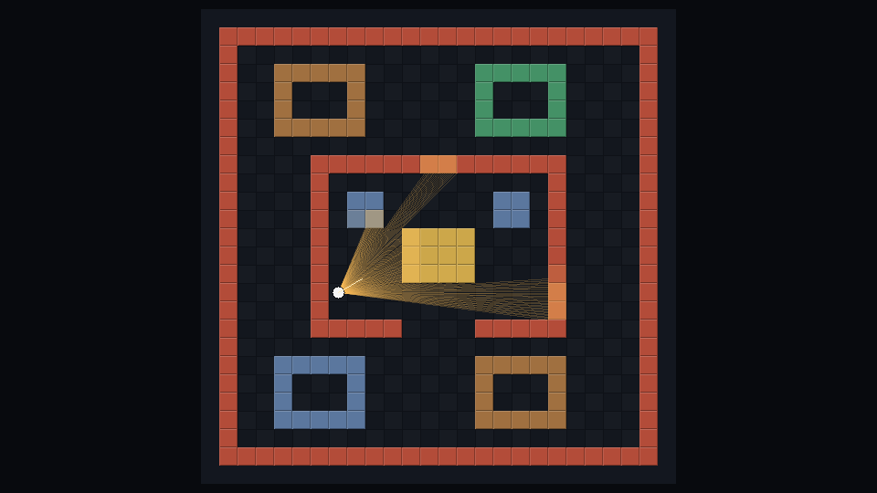

# ai-agent-test

Repository for Superagent tasks.

## C++ ray casting demo

[`raycasting.cpp`](raycasting.cpp) is a dependency-free C++17 implementation of
the classic Wolfenstein-style ray casting renderer. It casts one ray per screen
column with DDA grid traversal, projects the hits into textured and fog-shaded
vertical wall slices, casts a textured floor and ceiling, and draws the actual
ray fan in a top-down view so the algorithm can be inspected directly.



*First-person view with the minimap enabled. The minimap draws the rays that
produced the frame.*



*The `--map` view: the 24x24 grid, the player, five wall materials and the cast
ray fan.*

### Build and run

Requires a C++17 compiler. Interactive mode additionally needs a POSIX terminal
with 24-bit color support (Linux, macOS, WSL and most modern terminals qualify).

```sh
make
./raycasting
```

The demo opens in an interactive first-person view.

| Input | Action |
| --- | --- |
| `W`/`S` or `Up`/`Down` | Move forward/backward |
| `A`/`D` | Strafe left/right |
| `Left`/`Right` | Turn |
| `Tab` | Toggle the top-down ray view |
| `M` | Toggle the minimap |
| `Q`/`Esc` | Quit |

### Rendering frames and screenshots

```sh
./raycasting --render frame.ppm --width 960 --height 540 --minimap
./raycasting --render rays.ppm --width 960 --height 540 --map
python3 tools/ppm_to_png.py frame.ppm frame.png
```

`make screenshots` regenerates the two images above; the PNG converter uses
only the Python standard library.

Useful options (also listed by `./raycasting --help`):

| Option | Meaning |
| --- | --- |
| `--render <file.ppm>` | Render one frame and exit |
| `--map` | Top-down ray view |
| `--minimap` | Draw the minimap in the 3D view |
| `--width`, `--height` | Output size (default 960x540) |
| `--fov <deg>` | Horizontal field of view (default 75) |
| `--pos <x>,<y>` | Start position (default 6.5,14.5) |
| `--angle <deg>` | Start angle: 0 = east, 90 = south (default 330) |
| `--fps <n>` | Interactive frame cap (default 30) |
| `--selftest` | Run built-in checks |

### How it works

- **Map.** A 24x24 grid of five wall materials forms a small museum: four
  colored rooms around a brick inner hall with stone pillars and a golden
  fountain.
- **Ray casting.** For each screen column a ray is cast through the camera
  plane. The DDA walk visits grid cells in order and returns the first wall, its
  perpendicular distance, the wall side and a texture coordinate. Using
  perpendicular distance avoids fisheye distortion.
- **Projection.** The distance determines the height of a vertical wall slice.
  Slices sample 64x64 procedural textures, get side shading and blend into the
  distance fog.
- **Floor and ceiling.** Every screen row below (or above) the horizon has a
  constant distance to the floor (or ceiling) plane, so world-space texture
  coordinates can be interpolated linearly across the row: perspective-correct
  floor and ceiling casting without extra ray casts.
- **Top-down view.** Draws the map, the player and the cast ray fan, and
  highlights the wall cells the rays hit.
- **Tests.** `--selftest` checks map invariants, compares 1200 random DDA casts
  with an independent brute-force ray march, exercises axis-aligned rays and
  verifies the PPM writer.

### Verification

```sh
make test
```

The demo also builds cleanly with `-Wall -Wextra -Wpedantic -Werror`; the
GitHub Actions workflow in `.github/workflows/build.yml` builds, runs the
selftest and renders a frame.
